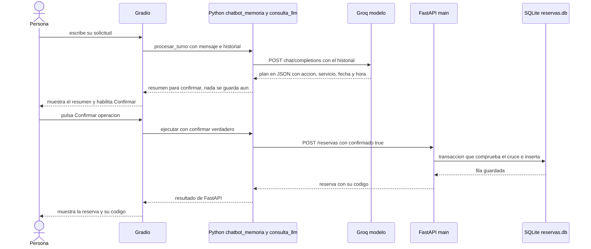

# Bitácora del segundo corte — OdontoAsistente

Documentación principal del segundo corte. El [README](../README.md) explica **cómo ejecutar** el proyecto; esta bitácora explica **cómo funciona, por qué se tomaron las decisiones y qué pruebas respaldan los resultados**.

**Contenido**

1. [Datos del corte y participación](#1-datos-del-corte-y-participación)
2. [Contexto y alcance](#2-contexto-y-alcance)
3. [Arquitectura y archivos](#3-arquitectura-y-archivos)
4. [Consumo del modelo](#4-consumo-del-modelo)
5. [Conversación](#5-conversación)
6. [API y persistencia](#6-api-y-persistencia)
7. [Disponibilidad](#7-disponibilidad)
8. [Evolución del proyecto](#8-evolución-del-proyecto)
9. [Decisiones técnicas](#9-decisiones-técnicas)
10. [Resultados](#10-resultados)
11. [Evidencias](#11-evidencias)
12. [Uso de inteligencia artificial](#12-uso-de-inteligencia-artificial)
13. [Defensa técnica y retroalimentación](#13-defensa-técnica-y-retroalimentación)
14. [Aprendizajes](#14-aprendizajes)
15. [Revisión antes de entregar](#15-revisión-antes-de-entregar)

## 1. Datos del corte y participación

| Campo                | Registro                                                                                                                                                                             |
| -------------------- | ------------------------------------------------------------------------------------------------------------------------------------------------------------------------------------ |
| Proyecto             | OdontoAsistente                                                                                                                                                                      |
| Curso                | Creación de Chatbots con IA (Electiva II), EAM-2026II                                                                                                                                |
| Corte                | Segundo corte                                                                                                                                                                        |
| Periodo de trabajo   | 2026-10-05 a 2026-10-21 (fechas de los commits)                                                                                                                                      |
| Repositorio          | https://github.com/darking2712/Odontoasistente                                                                                                                                       |
| Versión documentada  | Último commit previo: `c6f8ea1` (2026-10-21). Los cambios de revisión de la [sección 8.5](#85-revisión-de-cierre-2026-10-21) se publican en el commit de entrega: `[Completar hash]` |
| Bitácoras de soporte | [Clase 08–09 (2026-10-18)](C08-09_2026-10-18_Gradio_SQLite_Disponibilidad.md)                                                                                   |

| Integrante | Rol | Responsabilidad asumida | Aporte verificable |
|---|---|---|---|
| Kevin Londoño Hernandez | Desarrollo individual | Todo el proyecto: prompt y cliente del modelo, historial, interfaz Gradio, API y SQLite, pruebas y documentación | Commits de la [sección 8](#8-evolución-del-proyecto) y evidencias de la [sección 11](#11-evidencias) |

## 2. Contexto y alcance

**Negocio.** Consultorio OdontoAsistente, un consultorio odontológico **ficticio** en Armenia, Quindío (la dirección también es ficticia: Calle 45 #12-30).

**Problema.** Las personas escriben para preguntar por servicios y pedir citas, y alguien debe responder, revisar qué horas están libres y evitar que dos citas se crucen. El chatbot atiende ese primer contacto por conversación y deja las reservas guardadas.

**Usuarios.** Personas que quieren informarse o agendar, consultar y cancelar una cita desde una pantalla de chat.

**Funcionalidades**

- Informar servicios, precios, duración, horarios y ubicación.
- Consultar las horas libres para un servicio y una fecha.
- Crear, modificar, consultar y cancelar reservas, con confirmación explícita antes de guardar, modificar o cancelar.
- Rechazar reservas que se cruzan con otra activa, que terminan fuera del horario o que caen en una fecha u hora pasada.

**Límites.** No diagnostica, no recomienda tratamientos y no procesa pagos. Atiende a una sola persona a la vez (capacidad 1). Todos los datos son ficticios.

Servicios del catálogo ([`negocio.json`](../negocio.json)):

| Clave | Servicio | Precio (COP) | Duración |
|---|---|---:|---:|
| `valoracion` | Valoración general | 60.000 | 30 min |
| `limpieza` | Limpieza dental (profilaxis) | 90.000 | 45 min |
| `blanqueamiento` | Blanqueamiento dental | 350.000 | 60 min |
| `ortodoncia` | Consulta de ortodoncia | 70.000 | 30 min |
| `extraccion` | Extracción simple | 120.000 | 45 min |

Horario: lunes a viernes 08:00–18:00, sábado 08:00–13:00, domingo cerrado. Las horas se ofrecen en pasos de 30 minutos.

## 3. Arquitectura y archivos

El recorrido completo de una solicitud:



| Herramienta | Tarea en el proyecto |
|---|---|
| Gradio | Pantalla del chat, botones y estado de cada conversación |
| Python (biblioteca estándar `urllib`) | Llamar al modelo y a la API, y validar lo que devuelve el modelo |
| Groq | Interpretar el mensaje y devolver un plan en JSON |
| FastAPI | Reglas del negocio y validación de datos |
| SQLite | Guardar las reservas de forma persistente |

| Archivo | Contenido |
|---|---|
| [`app_gradio.py`](../app_gradio.py) | Interfaz Gradio: `enviar`, `confirmar`, `descartar`, `reiniciar` |
| [`chatbot_memoria.py`](../chatbot_memoria.py) | Historial de mensajes y llamada al modelo por turno |
| [`consulta_llm.py`](../consulta_llm.py) | Prompt, llamada a Groq, validación del plan y llamadas a la API |
| [`main.py`](../main.py) | API FastAPI y reglas propias del consultorio (`AgendaConsultorio`) |
| [`almacen_sqlite.py`](../almacen_sqlite.py) | Tabla `reservas`, transacciones y control de cruces |
| [`negocio.json`](../negocio.json) | Catálogo, precios, duraciones y horarios |
| [`reservas.db`](../reservas.db) | Base SQLite con reservas ficticias de prueba |
| [`probar_demo.py`](../probar_demo.py) | Prueba automática con base temporal |
| [`requirements.txt`](../requirements.txt) | Dependencias con versión fija |

Material de la versión anterior (Flowise y JSON), conservado solo para la comparación de la [sección 10.4](#104-comparación-con-la-versión-flowise): `Demo*.json`, [`puente_flowise.js`](../puente_flowise.js), [`prompt_sistema.txt`](../prompt_sistema.txt), [`reservas.json`](../reservas.json) y [`main_sqlite_ejemplo.py`](../main_sqlite_ejemplo.py) (referencia entregada en clase).

## 4. Consumo del modelo

El modelo **solo interpreta**: convierte el mensaje en un plan. No conoce precios ni disponibilidad, no confirma nada y no escribe en la base. Esas decisiones las toma el código.

| Elemento | Valor |
|---|---|
| Endpoint | `POST https://api.groq.com/openai/v1/chat/completions` |
| Modelo | Variable `GROQ_MODEL`. Modelo usado en las pruebas del corte: `openai/gpt-oss-20b` |
| Credencial | Variable `GROQ_API_KEY`, leída al iniciar `app_gradio.py`. Solo viaja en el encabezado `Authorization`; no se guarda en archivos, en el historial ni en la base |
| Encabezados | `Authorization: Bearer <clave>`, `Content-Type: application/json`, `Accept: application/json` y un `User-Agent` propio (`Mozilla/5.0 (OdontoAsistente)`), porque Groq (Cloudflare) rechaza con 403 el valor por defecto de `urllib` |
| Tiempo máximo | 30 segundos por petición |

**Payload** (`stream` en falso para recibir la respuesta completa):

```json
{
  "model": "<valor de GROQ_MODEL>",
  "messages": [
    {"role": "system", "content": "Eres el intérprete de un consultorio odontológico... Hoy es miércoles 2026-10-21."},
    {"role": "user", "content": "Quiero un blanqueamiento el 20 de octubre a las 10, a nombre de Laura"}
  ],
  "stream": false
}
```

**Respuesta.** El código lee `choices[0].message.content`. Como algunos modelos rodean el JSON con texto o con bloques de código, se recorta desde la primera `{` hasta la última `}` y se convierte con `json.loads`.

**Plan.** Formato que debe devolver el modelo (ejemplo ilustrativo del formato):

```json
{"accion": "crear", "cliente": "Laura", "servicio": "blanqueamiento", "fecha": "2026-10-20", "hora": "10:00", "codigo": ""}
```

**Validación del plan** (el JSON del modelo se trata como entrada no confiable):

- `accion` debe estar en `servicios`, `disponibilidad`, `crear`, `modificar`, `consultar`, `cancelar` o `fuera_de_alcance`; si no, se lanza un error.
- Solo se conservan las seis claves esperadas (`accion`, `cliente`, `servicio`, `fecha`, `hora`, `codigo`). Cualquier campo extra, como un `confirmado` inventado, se descarta.
- Cada valor se convierte a texto, el servicio a minúsculas y el código a mayúsculas.
- Si faltan datos obligatorios de la acción, no se llama a la API y se responde `Necesito: ...`.
- La confirmación no sale del modelo: el cuerpo enviado a la API incluye `"confirmado": true` únicamente cuando la persona pulsó **Confirmar operación**.

**Prompt y contexto** (`INSTRUCCIONES` en [`consulta_llm.py`](../consulta_llm.py)):

- Rol: intérprete de un consultorio odontológico que solo identifica la intención.
- Salida: únicamente un objeto JSON con las seis claves.
- Las siete acciones posibles con su significado; `fuera_de_alcance` para diagnósticos, tratamientos o pagos.
- Las cinco claves exactas de servicio; cadena vacía si no corresponde ninguna.
- Formatos: fecha `AAAA-MM-DD`, hora `HH:MM` en 24 horas y código de 8 caracteres hexadecimales.
- Contexto de fecha: se inyecta el día y la fecha actuales en la zona horaria `America/Bogota`, para que el modelo entienda "mañana" o "el viernes".
- Si un dato no aparece, usar cadena vacía; no inventarlo ni afirmar que se hizo una reserva.

**Errores del modelo o la red** (los muestra `app_gradio.py` sin cerrar la conversación):

| Situación | Mensaje en pantalla |
|---|---|
| Groq o FastAPI responden con error HTTP | `Error HTTP <código>. Revisa Groq o FastAPI.` |
| Sin conexión o tiempo agotado | `No pude conectar con Groq o FastAPI.` |
| Respuesta que no es el JSON esperado | `La respuesta no tiene el formato esperado.` |
| Faltan `GROQ_API_KEY` o `GROQ_MODEL` | `Configura GROQ_API_KEY y GROQ_MODEL e inicia de nuevo.` |

## 5. Conversación

**Roles e historial.** La lista `messages` usa tres roles: `system` (el prompt, creado con `nuevo_historial()`), `user` (lo que escribe la persona) y `assistant`. En cada turno el historial se envía completo al modelo. Lo que se guarda como `assistant` no es el texto bonito de la pantalla, sino un resumen en JSON con el plan y la respuesta (`{"plan": ..., "respuesta": ...}`), para que el modelo vea lo que ya se hizo.

**Funciones**

| Función | Archivo | Qué hace |
|---|---|---|
| `nuevo_historial()` | `chatbot_memoria.py` | Crea el historial con solo el mensaje `system` |
| `interpretar_turno()` | `chatbot_memoria.py` | Añade la pregunta, llama a Groq y valida el plan |
| `procesar_turno()` | `chatbot_memoria.py` | Interpreta y ejecuta lo que no necesita confirmación |
| `ejecutar()` | `consulta_llm.py` | Pide confirmación para crear, modificar y cancelar; con `confirmar=True` llama a la API |
| `enviar()` | `app_gradio.py` | Valida el mensaje, procesa el turno y guarda la solicitud pendiente |
| `confirmar()` | `app_gradio.py` | Ejecuta la operación pendiente y registra el resultado en el historial |
| `descartar()` | `app_gradio.py` | Descarta la solicitud sin llamar a la API |
| `reiniciar()` | `app_gradio.py` | Crea un estado nuevo con el historial vacío |

**Estado por sesión.** `gr.State` crea un diccionario propio para cada conversación del navegador, con tres claves: `historial` (mensajes para el modelo), `pantalla` (lo que ve la persona) y `pendiente` (el plan a la espera de confirmación, o `None`). Vive en memoria, no en la base.

**Confirmación.** Consultar servicios, disponibilidad o una reserva se ejecuta de inmediato. Crear, modificar y cancelar devuelven primero un resumen (`Voy a crear la reserva: ... ¿Confirmas?`) y guardan el plan como pendiente. Mientras haya una solicitud pendiente, `enviar()` rechaza mensajes nuevos con "Confirma o descarta la solicitud pendiente primero".

**Reinicio.** El botón **Reiniciar conversación** y el icono de borrar del chat llaman a `reiniciar()`: la pantalla y el historial quedan vacíos (solo el `system`) y la solicitud pendiente se elimina. Las reservas ya guardadas no se tocan.

**Concurrencia.** Los cinco eventos de la interfaz comparten un límite de concurrencia de 1, de modo que envío, confirmación y reinicio no se solapan.

## 6. API y persistencia

La API ([`main.py`](../main.py)) valida cada petición con modelos de Pydantic (`extra="forbid"`; `confirmado` solo acepta `true`) y traduce los errores del almacén a códigos HTTP.

| Método y ruta | Operación | Respuestas |
|---|---|---|
| `GET /servicios` | Catálogo, precios y horarios | 200 |
| `GET /disponibilidad?fecha&servicio` | Horas libres | 200; 422 si el servicio no existe |
| `GET /reservas` | Lista de reservas | 200; 503 |
| `POST /reservas` | Crea (requiere `confirmado: true`) | 201; 409 cruce; 422 datos; 503 |
| `GET /reservas/{codigo}` | Consulta | 200; 404 |
| `PUT /reservas/{codigo}` | Cambia servicio, fecha y hora | 200; 404; 409; 422; 503 |
| `DELETE /reservas/{codigo}?confirmado=true` | Cancela | 200; 404; 409 ya cancelada; 422 sin confirmar; 503 |
| `POST /chat` | Puente de la versión Flowise. Gradio no lo usa | 200; 409; 422 |

Códigos de error: **404** reserva no encontrada, **409** conflicto (cruce o estado inválido), **422** datos inválidos, **503** la base de datos no respondió. Los códigos de reserva se normalizan con `strip()` y `upper()`.

**Tabla `reservas`** ([`almacen_sqlite.py`](../almacen_sqlite.py)), más el índice `idx_fecha_estado` sobre `(fecha, estado)`:

| Campo | Tipo | Restricción | Contenido |
|---|---|---|---|
| `codigo` | TEXT | Clave primaria | 8 caracteres hexadecimales en mayúsculas, generados con `uuid4` |
| `cliente` | TEXT | No nulo | Nombre de la persona |
| `servicio` | TEXT | No nulo | Clave del catálogo |
| `fecha` | TEXT | No nulo | `AAAA-MM-DD` |
| `hora` | TEXT | No nulo | `HH:MM` |
| `duracion_minutos` | INTEGER | No nulo, mayor que 0 | Duración copiada del catálogo al reservar |
| `estado` | TEXT | `activa` o `cancelada` | Estado de la reserva |

**Operaciones**

| Operación | Método del almacén | SQL principal |
|---|---|---|
| Crear | `crear()` | `SELECT` de reservas activas del día, comprobación del cruce e `INSERT`, todo en una transacción |
| Consultar | `consultar()` | `SELECT * ... WHERE codigo=?` |
| Modificar | `modificar()` | `SELECT`, comprobación del cruce excluyendo la propia reserva y `UPDATE` de servicio, fecha, hora y duración |
| Cancelar | `cancelar()` | `UPDATE ... SET estado='cancelada'` |
| Disponibilidad | `disponibilidad()` | `SELECT hora, duracion_minutos` de las reservas activas de esa fecha |
| Listar | `listar()` | `SELECT * ... ORDER BY fecha, hora, codigo` |

El precio **no** se guarda: se toma del catálogo al responder (`con_precio()`). Cada operación abre su propia conexión.

## 7. Disponibilidad

**Horario.** `AgendaSQLite` admite un solo horario para todos los días; como el sábado cierra a las 13:00, `main.py` define la subclase `AgendaConsultorio`, que valida el horario de cada día y además rechaza las horas que ya pasaron hoy (zona `America/Bogota`). Una atención debe **terminar** dentro del horario: el último inicio posible de una valoración (30 min) el sábado es 12:30. Las horas siguen un paso de 30 minutos contado desde la apertura.

**Duración.** Cada reserva ocupa el intervalo `[inicio, inicio + duración)` y guarda su duración en la tabla.

**Cruce de intervalos.** Un intervalo nuevo se cruza con uno activo cuando

```
inicio_nuevo < fin_existente   y   fin_nuevo > inicio_existente
```

Si uno empieza justo cuando termina el otro, **no** hay cruce. Las reservas canceladas no cuentan.

Ejemplo comprobado en la clase 08–09 con una reserva activa de Laura (blanqueamiento, 10:00–11:00, 60 min) el 2026-10-20:

| Solicitud | Intervalo | Resultado |
|---|---|---|
| Valoración a las 09:30 | 09:30–10:00 | Libre: termina cuando empieza la de Laura (la disponibilidad salta de 09:30 a 11:00) |
| Valoración a las 10:30 | 10:30–11:00 | Rechazada, HTTP 409: "El intervalo solicitado se cruza con una reserva activa" |
| Valoración a las 11:00 | 11:00–11:30 | Aceptada, HTTP 201: empieza cuando termina la de Laura |

**Transacción.** `conexion(escritura=True)` abre la transacción con `BEGIN IMMEDIATE`, que reserva la escritura *antes* de comprobar. Así la comprobación del cruce y el `INSERT` ocurren como un solo paso: si dos personas piden el mismo intervalo a la vez, la segunda espera, ve el intervalo ocupado y recibe 409. Si algo falla dentro de la transacción se hace `rollback()` y no queda ninguna fila a medias. Si la base no se libera en 10 segundos, la API responde 503.

**Modificar.** Al reagendar se excluye la propia reserva de la comprobación, de modo que puede solaparse con su horario anterior (por ejemplo, cambiar de valoración a limpieza a la misma hora). Una reserva cancelada no se puede modificar ni cancelar de nuevo (409).

## 8. Evolución del proyecto

En todos los avances participó Kevin Londoño Hernandez (trabajo individual). Las fechas son las de los commits en GitHub; el apoyo de IA se declara en la [sección 12](#12-uso-de-inteligencia-artificial).

### 8.0 Punto de partida: Flowise, FastAPI y JSON (hasta 2026-09-13)

- **Qué había.** Dos flujos en Flowise (Demo 2: Groq con memoria; Demo 3: Flowise + FastAPI), una API en `main.py` que guardaba reservas en `reservas.json`, y `probar_demo.py` para probarla. Commit `2a59162` (2026-09-13).
- **Dificultad.** Groq dejó de dar soporte a `llama-3.3-70b-versatile`; el Demo 3 pasó a `openai/gpt-oss-20b`.
- **Comprobación.** Se probó reservar y cancelar citas de prueba; `reservas.json` conserva esos registros con sus marcas de tiempo (`creada_en`, `cancelada_en`).

### 8.1 Primera llamada al modelo desde Python (2026-10-05)

- **Qué cambió.** Nace [`consulta_llm.py`](../consulta_llm.py): prompt, petición a Groq con `urllib`, extracción del plan en JSON y llamadas a la API. Se deja de depender de Flowise para interpretar. Commit `3b5d985` (2026-10-05 09:32).
- **Dificultad.** Groq (Cloudflare) devolvía 403 con el `User-Agent` por defecto de `urllib`; se añadió uno propio.
- **Comprobación.** Ejecución de `consulta_llm.py` desde la terminal con una solicitud de ejemplo: Con la solicitud "Quiero una valoración el 2026-10-23 a las 09:00 a nombre de Laura", el modelo devolvió el plan `{"accion": "crear", "cliente": "Laura", "servicio": "valoracion", "fecha": "2026-10-23", "hora": "09:00", "codigo": ""}`. El chatbot respondió con el resumen "¿Confirmas?" y, tras confirmar, FastAPI creó la reserva `9CA27B83` (30 min, 60.000 COP, estado `activa`). Un primer intento falló con "No pude conectar con Groq o con la FastAPI" porque la API estaba apagada (evidencia 18).

### 8.2 Conversación con historial (2026-10-05)

- **Qué cambió.** Nace [`chatbot_memoria.py`](../chatbot_memoria.py): lista `messages` con roles, resumen de cada turno en el historial y comandos `REINICIAR` y `SALIR`. Mismo commit `3b5d985`.
- **Dificultad.** `[Completar]`
- **Comprobación.** La terminal muestra "Mensajes en el historial" tras cada turno y `REINICIAR` deja solo el mensaje `system`.

### 8.3 Modificar reservas (2026-10-05)

- **Qué cambió.** Se agrega `PUT /reservas/{codigo}` en la API y la acción `modificar` en el prompt y el cliente (requiere código, servicio, fecha y hora). Commit `bc79d98` (2026-10-05 09:41).
- **Dificultad.** `[Completar]`
- **Comprobación.** Con la versión final, la modificación se probó desde Gradio con Groq (2026-10-21): la reserva `F45FD1A4` pasó a 2026-10-23, 11:00 y la fila de SQLite refleja el cambio (evidencias 16, 16b y 16c). La versión SQLite también se prueba de forma automática en la [sección 10.1](#101-pruebas).

### 8.4 Interfaz Gradio e integración de SQLite (clase 2026-10-18)

- **Qué cambió.** `main.py` deja de leer y escribir `reservas.json` y usa `AgendaConsultorio` sobre `reservas.db`; la disponibilidad pasa a considerar la duración del servicio; se enciende [`app_gradio.py`](../app_gradio.py) con una conversación por sesión. Detalle completo en la [bitácora de la clase 08–09](C08-09_2026-10-18_Gradio_SQLite_Disponibilidad.md). El código se publicó en el commit `c6f8ea1` (2026-10-21 08:33).
- **Dificultades.** (1) Error HTTP 401 de Groq en el primer mensaje: la clave no estaba cargada en esa terminal. (2) El aviso "Confirma o descarta la solicitud pendiente primero", que no era un fallo. (3) Gradio mostró solo "HTTP 409" al rechazar un cruce, sin el motivo.
- **Comprobación.** Cinco pruebas de la guía con capturas (evidencias 1 a 12 de la [sección 11](#11-evidencias)): reserva de Laura (`F45FD1A4`), rechazo con 409 y reserva pegada aceptada con 201.

### 8.5 Revisión de cierre (2026-10-21)

Se revisó el repositorio contra los requisitos de la entrega y se corrigió lo que no funcionaba:

| Hallazgo | Corrección |
|---|---|
| `probar_demo.py` seguía probando el JSON (`main.ARCHIVO`) y ya no se podía ejecutar | Reescrito para SQLite con una base temporal: 57 comprobaciones que no tocan `reservas.db` |
| `requirements.txt` no incluía Gradio, y `fastapi==0.115.12` es incompatible con `gradio==6.30.0` (Gradio exige `starlette>=1.0.1`): `pip` fallaba con `ResolutionImpossible` | Versiones fijas compatibles: `fastapi==0.159.0`, `uvicorn==0.54.0`, `gradio==6.30.0` (el `fastapi` y el `uvicorn` anteriores quedaron reemplazados) |
| El prompt describía los códigos como `OA-XXXXXXXXXXXX` (formato de la versión JSON), pero los de SQLite son de 8 caracteres | Prompt corregido (`1A2B3C4D` como ejemplo) |
| Un fallo de SQLite producía un error 500 sin explicación; la versión JSON sí respondía 503 | `ejecutar()` en `main.py` traduce `sqlite3.Error` a 503, y `GET /reservas` también pasa por ahí |
| Docstring de `consulta_llm.py` decía que no había `PUT`; la interfaz se llamaba "Chatbot del equipo" | Textos actualizados; título "OdontoAsistente" |
| Faltaban `README.md`, `.gitignore` y esta bitácora; el repositorio incluía `__pycache__` | Documentos creados; `.gitignore` agregado y `__pycache__` retirado con `git rm -r --cached` |

- **Comprobación.** Se creó un entorno nuevo con `pip install -r requirements.txt` y se ejecutaron `probar_demo.py`, la API (`/docs` y `/servicios` responden 200), Gradio (responde 200) y la migración opcional de `reservas.json` (4 reservas importadas). Para confirmar que la prueba detecta el fallo, se quitó el manejo del 503 y la sección 8 de `probar_demo.py` dejó de pasar.
- **Respaldo.** [`evidencias/probar_demo_salida.txt`](evidencias/probar_demo_salida.txt) y el commit de entrega `[Completar hash]`.

## 9. Decisiones técnicas

| Decisión | Razón | Alternativa descartada |
|---|---|---|
| **Separar conversación y negocio.** El modelo solo propone un plan; Gradio pide la confirmación y FastAPI aplica las reglas | El modelo no debe poder guardar, cancelar ni cambiar precios. La confirmación llega solo con el botón y el campo `confirmado` lo pone el código | Dejar que el modelo ejecute operaciones o confirme por sí mismo |
| **Organizar las funciones por capa.** `consulta_llm.py` (prompt, validación, API), `chatbot_memoria.py` (historial) y `app_gradio.py` (pantalla y estado) | La interfaz importa `procesar_turno()` y `ejecutar()` sin copiar la lógica; se puede probar la terminal y Gradio con el mismo código | Un solo archivo con todo mezclado |
| **Guardar la duración en cada reserva** y no solo la clave del servicio | La disponibilidad compara intervalos completos y un cambio posterior del catálogo no altera las reservas ya hechas | Calcular la duración desde el catálogo cada vez |
| **Conservar las reservas canceladas** con estado `cancelada` | Queda el historial y el intervalo se libera porque solo cuentan las `activa` | Borrar la fila al cancelar |
| **Cancelar o modificar una reserva ya cancelada devuelve 409** | Es un conflicto de estado, no una operación válida. La versión JSON respondía 200 al cancelar dos veces | Tratarla como éxito silencioso |
| Subclase `AgendaConsultorio` en `main.py` | `AgendaSQLite` acepta un solo horario para todos los días y el sábado cierra a las 13:00; además rechaza horas pasadas de hoy | Horario único de 08:00 a 18:00, que habría permitido reservar el sábado por la tarde |
| Llamar `ejecutar()` a la función que traduce errores a HTTP | `responder()` ya lo usa el endpoint `/chat` | Renombrar la función del chat |
| Mantener la clave `horarios` en `/disponibilidad` | El cliente `consulta_llm.py` ya la lee; el almacén devuelve `horas` | Cambiar el cliente |
| Tomar el precio del catálogo y no guardarlo en la tabla | La tabla solo guarda duración; el precio se agrega al responder | Añadir una columna `precio_cop` |
| Conservar las rutas sin `/api` | El cliente ya usa `/servicios`, `/disponibilidad` y `/reservas` | Usar `/api/...` y adaptar el cliente |
| Errores de SQLite como 503 | La persona recibe un mensaje claro y puede reintentar; antes era un 500 | Dejar que la excepción llegue sin traducir |
| Probar con una base temporal | `probar_demo.py` no debe alterar las reservas de la clase | Probar sobre `reservas.db` |
| Versiones fijas en `requirements.txt` | Una copia nueva instala exactamente lo que se probó | Rangos abiertos |

## 10. Resultados

### 10.1 Pruebas

Dos fuentes de evidencia: las pruebas manuales de la clase 08–09 (Gradio, Groq, FastAPI y SQLite reales) y la prueba automática [`probar_demo.py`](../probar_demo.py), que usa una base temporal y **no llama a Groq**. Su salida completa está en [`evidencias/probar_demo_salida.txt`](evidencias/probar_demo_salida.txt) (57 comprobaciones `[OK]`).

| Prueba | Entrada o acción | Resultado esperado | Resultado obtenido | Evidencia | Estado |
|---|---|---|---|---|---|
| **1. Conversación en varios turnos** | Pedir una reserva en varios mensajes, aportando los datos que faltan en turnos posteriores | El chat conserva lo dicho y arma un solo resumen para confirmar | Se completó la reserva `F45FD1A4` (Laura, blanqueamiento, 2026-10-20, 10:00). En `/chat`, corregir la hora conserva los demás datos | Evidencia 6 y JSON de la [sección 11](#11-evidencias); `probar_demo_salida.txt`, apartado 7 | Cumplida |
| **2. Dos sesiones y reinicio** | Dos conversaciones (ventana normal y privada) y luego **Reiniciar** | Datos propios en cada una; el reinicio vacía el historial y conserva las filas | Cumplida en la clase 08–09 y repetida el 2026-10-21: con Laura y Pedro en ventanas distintas, **Reiniciar** vació solo la sesión de Pedro y la de Laura conservó su resumen pendiente. La prueba automática cubre las sesiones de `/chat` (puente de Flowise), no el `gr.State` de Gradio | Evidencias 15, 15b y 15c; apartado 7 de la salida | Cumplida |
| **3. Crear, modificar y cancelar** | Crear una reserva, cambiarla con `PUT` y cancelarla; luego un `SELECT` en SQLite | Las filas reflejan cada cambio y la cancelada se conserva | Crear: fila de Laura (evidencia 6). Modificar y cancelar: la fila queda en `valoracion`, 11:00, 30 min y luego `cancelada`, sin borrarse | Evidencias 6, 16, 16b y 16c; apartados 5 y 6 de la salida | Cumplida en la API y desde Gradio con Groq (2026-10-21): modificar `F45FD1A4` a 2026-10-23, 11:00 respondió 200 y el `SELECT` lo refleja | 
| **4. Intervalos ocupados** | Blanqueamiento a las 10:00 y valoración a las 10:30; luego a las 11:00 | 10:30 rechazada (409) y sin fila nueva; 11:00 aceptada (201) | 409 con "El intervalo solicitado se cruza con una reserva activa"; el `SELECT` no mostró fila de Pedro; a las 11:00 se aceptó. En la prueba automática, limpieza a las 08:30 y 09:00 contra una valoración de 09:00 también dan 409 | Evidencias 7 a 12; apartado 4 de la salida | Cumplida |
| **5. Cancelación y persistencia** | Cancelar una reserva; reiniciar la API; consultar | El horario se libera y las filas siguen en SQLite | La cancelación libera el horario y conserva la fila. Las reservas continúan tras reiniciar la API (comprobado el 2026-10-21 con Ctrl+C y nuevo arranque de uvicorn); la prueba automática lo simula con un objeto nuevo sobre el mismo archivo | Apartados 3 y 6 de la salida; evidencia 17: tras apagar y encender uvicorn, el `SELECT` devuelve las mismas dos filas | Cumplida |
| **6. Errores** | Clave de Groq inválida; reserva en intervalo ocupado; hora o fecha inválidas; fallo de SQLite | Mensaje claro y la conversación puede continuar | 401 de Groq resuelto recargando la clave; 409 mostrado en Gradio y con motivo en `/docs`; 422 para datos inválidos; 503 si falla SQLite, y luego la API sigue funcionando | Evidencias 3, 4, 8 y 10; apartados 1 y 8 de la salida | Cumplida, con la limitación de la [sección 10.3](#103-limitaciones) |

Resumen de `probar_demo.py`:

| Apartado | Qué comprueba | Comprobaciones |
|---|---|---:|
| 1 | Validaciones: sin confirmar, hora o servicio inválidos, fuera de horario o del paso, fecha pasada, domingo cerrado, cierre del sábado | 11 |
| 2 | Dos peticiones simultáneas por el mismo horario: una 201 y una 409 | 2 |
| 3 | Persistencia al reiniciar la API y código inexistente (404) | 2 |
| 4 | Cruce de intervalos, extremos que se tocan y rechazo con 409 | 6 |
| 5 | Modificar: confirmación, 404, 409, solape con la propia reserva y estado en SQLite | 8 |
| 6 | Cancelar: confirmación, doble cancelación, liberación del horario y fila conservada | 6 |
| 7 | Chat: varios turnos, confirmación, dos sesiones, reinicio, inyección de `confirmado` y horario ocupado entre resumen y confirmación | 18 |
| 8 | Errores de almacenamiento: 503 y recuperación | 4 |
| | **Total** | **57** |

### 10.2 Errores encontrados y su estado

| Problema | Causa | Solución | Verificación | Estado |
|---|---|---|---|---|
| Error HTTP 401 en el primer mensaje de Gradio | Causa probable: la clave de Groq no estaba cargada en esa terminal (FastAPI no pide autenticación) | Se pidió la clave con `Read-Host -AsSecureString`, se asignó a `$env:GROQ_API_KEY` y se reinició Gradio | El chat respondió y se completó la reserva de Laura | Resuelto (2026-10-18) |
| "Confirma o descarta la solicitud pendiente primero" | No es un fallo: Gradio bloquea mensajes nuevos con una operación pendiente | Confirmar o descartar antes de seguir | El siguiente mensaje se envió sin aviso | Comportamiento esperado |
| Gradio muestra solo "HTTP 409" al confirmar un cruce | `confirmar()` solo muestra el código, no el motivo | Se repitió la petición en `/docs` para ver el mensaje | `/docs` devolvió 409 con el motivo y no quedó fila | **Abierto**: mejora propuesta en la [sección 10.3](#103-limitaciones) |
| `probar_demo.py` no se podía ejecutar | Seguía usando `main.ARCHIVO` y `reservas.json` tras migrar a SQLite | Reescrito para SQLite con base temporal | 57 comprobaciones `[OK]` | Resuelto (2026-10-21) |
| `pip install -r requirements.txt` fallaba | Faltaba Gradio y `fastapi==0.115.12` choca con `gradio==6.30.0` | Versiones fijas compatibles | Instalación en un entorno nuevo y ejecución de todo | Resuelto (2026-10-21) |
| Código de reserva descrito con el formato antiguo en el prompt | El prompt conservó `OA-XXXXXXXXXXXX` de la versión JSON | Prompt corregido a 8 caracteres hexadecimales | Revisión del código. Probado el 2026-10-21 en Gradio con Groq: `Consulta la reserva 9CA27B83` devolvió el resultado de FastAPI con la reserva de Laura, sin pedir confirmación (evidencia 19) | Resuelto (2026-10-21) |
| `PUT` sobre la reserva de Pedro (`99C73722`, 2026-10-20) respondió 422 | Causa probable: la fecha ya había pasado y la API rechaza fechas pasadas (a verificar) | Se modificó otra reserva (`F45FD1A4`, 2026-10-23), que respondió 200 | Registro de uvicorn del 2026-10-21 (evidencia 17) | Comportamiento esperado |
| Fallo de SQLite devolvía 500 | `ejecutar()` no traducía `sqlite3.Error` | Traducción a 503 | Sección 8 de `probar_demo.py`; al quitar el manejo, la prueba falla | Resuelto (2026-10-21) |

### 10.3 Limitaciones

- **API sin autenticación.** Es solo para uso local; no debe publicarse en internet.
- **Estado en memoria.** El historial y la solicitud pendiente de Gradio se pierden al recargar la página. Las reservas guardadas no.
- **La memoria entre turnos depende del modelo.** El código no combina los datos de turnos anteriores: el modelo debe reconstruir el plan completo leyendo el historial y puede interpretar mal un mensaje ambiguo (en la versión Flowise, la API combinaba los datos en el servidor).
- **Historial sin recorte.** Crece con la conversación y la fecha de "hoy" queda fija al crearlo: una conversación abierta pasada la medianoche sigue con el día anterior.
- **Errores poco descriptivos en Gradio.** Para 409 o 422 muestra solo el código HTTP. Mejora propuesta: mostrar el mensaje de la API con `detalle_error()`, que ya existe en `consulta_llm.py`.
- **Cola global.** El límite de concurrencia compartido hace que las operaciones del chat se atiendan una a la vez.
- **Un solo profesional.** La capacidad es 1; el código no maneja varios.
- **Precio no guardado.** Si cambia el catálogo, cambia el precio mostrado de reservas antiguas.
- **El modelo no está cubierto por la prueba automática.** `probar_demo.py` no llama a Groq; la interpretación del modelo solo se verificó manualmente.
- **Restos de la versión anterior.** `POST /chat` y sus sesiones en memoria siguen en `main.py` aunque Gradio no los usa; la API debe ejecutarse con un solo proceso por ese estado.
- **Datos de prueba.** Las reservas de `reservas.db` son ficticias y sus fechas ya pasaron.

### 10.4 Comparación con la versión Flowise

| Aspecto | Flowise + JSON (corte anterior) | Python + Gradio + SQLite (este corte) | Qué asumió el código |
|---|---|---|---|
| Interpretación | Flujo visual en Flowise que extrae la intención con Groq | `interpretar_turno()` en Python | Armar el payload y los encabezados, llamar a Groq, extraer y validar el JSON |
| Memoria | Nodo de memoria de Flowise | Lista `messages` en el estado de Gradio | Decidir qué se guarda en el historial y cuándo reiniciarlo |
| Interfaz | Chat de Flowise | Gradio | Botones de confirmar, descartar y reiniciar, y bloqueo con solicitud pendiente |
| Estado y confirmación | `POST /chat` con diccionario `SESIONES` y la palabra `CONFIRMAR` | `gr.State` por sesión y botón **Confirmar operación** | Guardar la solicitud pendiente y ejecutarla solo tras confirmar |
| Persistencia | `reservas.json` con bloqueo en memoria y reemplazo atómico del archivo | SQLite con transacción `BEGIN IMMEDIATE` | Crear la tabla, las consultas y el manejo de transacciones |
| Disponibilidad | Cruce de intervalos calculado sobre la lista de reservas en memoria | Intervalos con duración guardada y comprobación dentro de la transacción | Impedir cruces aunque dos peticiones lleguen a la vez |
| Errores | 503 si fallaba el archivo | 503 si falla SQLite; 404, 409 y 422 desde la API | Traducir cada error a un mensaje comprensible |
| Pruebas | `probar_demo.py` sobre un JSON temporal | `probar_demo.py` sobre una base SQLite temporal (57 comprobaciones) | Escribir y mantener las pruebas |

En resumen: Flowise resolvía visualmente la interpretación y la memoria; con Python esas piezas pasaron a ser código propio. A cambio hay más control (validación del plan, confirmación fuera del modelo, transacciones) y más responsabilidad (credenciales, errores, historial y pruebas).

## 11. Evidencias

Las imágenes están en [`evidencias/`](evidencias/). Las capturas 1 a 12 son las de la [clase 08–09](C08-09_2026-10-18_Gradio_SQLite_Disponibilidad.md).

| N.º    | Tipo    | Qué se estaba probando y qué demuestra                                                                                                                                                                                                                                                                                       | Archivo                                                                                                                                                                                                                          |
| ------ | ------- | ---------------------------------------------------------------------------------------------------------------------------------------------------------------------------------------------------------------------------------------------------------------------------------------------------------------------------- | -------------------------------------------------------------------------------------------------------------------------------------------------------------------------------------------------------------------------------- |
| 1      | Captura | Instalación de Gradio 6.30.0 en el entorno virtual: la dependencia de la interfaz                                                                                                                                                                                                                                            | [`C08-09_01_gradio_instalado.png`](evidencias/C08-09_01_gradio_instalado.png)                                                                                                                                                    |
| 2      | Captura | `app_gradio.py` en ejecución en `http://127.0.0.1:7860`                                                                                                                                                                                                                                                                      | [`C08-09_02_gradio_en_ejecucion.png`](evidencias/C08-09_02_gradio_en_ejecucion.png)                                                                                                                                              |
| 3      | Captura | Error HTTP 401 de Groq con la clave sin cargar                                                                                                                                                                                                                                                                               | [`C08-09_03_error_401_groq.png`](evidencias/C08-09_03_error_401_groq.png)                                                                                                                                                        |
| 4      | Captura | Clave pedida de forma oculta con `Read-Host -AsSecureString` y Gradio reiniciado                                                                                                                                                                                                                                             | [`C08-09_04_clave_recargada.png`](evidencias/C08-09_04_clave_recargada.png)                                                                                                                                                      |
| 5      | Demo    | Consulta de servicios en Gradio: devuelve el catálogo de `negocio.json`                                                                                                                                                                                                                                                      | [`negocio.json`](../negocio.json)                                                                                                                                                                                                |
| 6      | Captura | `SELECT` en `reservas.db`: la reserva confirmada de Laura quedó guardada                                                                                                                                                                                                                                                     | [`C08-09_06_sqlite_reserva_laura.png`](evidencias/C08-09_06_sqlite_reserva_laura.png)                                                                                                                                            |
| 7      | Captura | Disponibilidad de una valoración el 2026-10-20 tras reservar: salta de 09:30 a 11:00                                                                                                                                                                                                                                         | [`C08-09_07_disponibilidad_despues.png`](evidencias/C08-09_07_disponibilidad_despues.png)                                                                                                                                        |
| 8      | Captura | Gradio muestra HTTP 409 al confirmar la valoración de las 10:30                                                                                                                                                                                                                                                              | [`C08-09_08_gradio_409_cruce.png`](evidencias/C08-09_08_gradio_409_cruce.png)                                                                                                                                                    |
| 9      | Captura | `SELECT` tras el rechazo: solo sigue la fila de Laura                                                                                                                                                                                                                                                                        | [`C08-09_09_sqlite_sin_fila_pedro.png`](evidencias/C08-09_09_sqlite_sin_fila_pedro.png)                                                                                                                                          |
| 10     | Captura | `/docs`, `POST /reservas` a las 10:30: 409 con el motivo del cruce                                                                                                                                                                                                                                                           | [`C08-09_10_docs_409_cruce.png`](evidencias/C08-09_10_docs_409_cruce.png)                                                                                                                                                        |
| 11     | Captura | `/docs`, `POST /reservas` a las 11:00: 201, la reserva pegada se acepta                                                                                                                                                                                                                                                      | [`C08-09_11_docs_201_pegada.png`](evidencias/C08-09_11_docs_201_pegada.png)                                                                                                                                                      |
| 12     | Captura | `SELECT` con las dos filas activas: Laura 10:00 y Pedro 11:00                                                                                                                                                                                                                                                                | [`C08-09_12_sqlite_dos_filas.png`](evidencias/C08-09_12_sqlite_dos_filas.png)                                                                                                                                                    |
| 13     | Texto   | Salida completa de `probar_demo.py` en una copia limpia: 57 comprobaciones `[OK]` en 8 apartados                                                                                                                                                                                                                             | [`probar_demo_salida.txt`](evidencias/probar_demo_salida.txt)                                                                                                                                                                    |
| 14     | Captura | `probar_demo.py` ejecutado en el equipo local (Windows), apartados 1 a 8: todas las comprobaciones `[OK]` y el mensaje final                                                                                                                                                                                                 | [`14_probar_demo_local.png`](evidencias/14_probar_demo_local.png) y [`14.2_probar_demo_local.png`](evidencias/14.2_probar_demo_local.png)                                                                                        |
| 15     | Captura | Dos ventanas con solicitudes distintas (Laura 09:00, Pedro 14:00) y reinicio de la de Pedro: queda vacía y la de Laura conserva su resumen                                                                                                                                                                                   | [`15_dos_sesiones_gradio.png`](evidencias/15_dos_sesiones_gradio.png), [`15b_reinicio_gradio.png`](evidencias/15b_reinicio_gradio.png) y [`15c_sesion_intacta_gradio.png`](evidencias/15c_sesion_intacta_gradio.png)             |
| 16     | Captura | Modificar `F45FD1A4` desde Gradio (resumen y confirmación), respuesta de FastAPI y `SELECT` con el cambio. Orden de columnas del `SELECT`: código, cliente, servicio, fecha, hora, duración, estado. La reserva pasó de 2026-10-20 10:00 a 2026-10-23 11:00; por eso `reservas.db` ya no coincide con las capturas 6, 7 y 12 | [`16_modificar_reserva.png`](evidencias/16_modificar_reserva.png), [`16b_modificar_respuesta_fastapi.png`](evidencias/16b_modificar_respuesta_fastapi.png) y [`16c_select_modificada.png`](evidencias/16c_select_modificada.png) |
| 17     | Captura | Uvicorn apagado con Ctrl+C y encendido de nuevo; el `SELECT` posterior devuelve las dos reservas (Laura 11:00 y Pedro 11:00)                                                                                                                                                                                                 | [`17_persistencia_reinicio_api.png`](evidencias/17_persistencia_reinicio_api.png) y [`17.2_persistencia_reinicio_api.png`](evidencias/17.2_persistencia_reinicio_api.png)                                                        |
| 18     | Captura | `consulta_llm.py` en terminal: el modelo devuelve el plan JSON, el chatbot pide confirmación y FastAPI crea la reserva `9CA27B83`. Queda guardada en `reservas.db` como dato de prueba                                                                                                                                       | [`18_consulta_llm_terminal.png`](evidencias/18_consulta_llm_terminal.png)                                                                                                                                                        |
| 19     | Captura | Consulta por código en Gradio: `Consulta la reserva 9CA27B83` devuelve la reserva sin pedir confirmación                                                                                                                                                                                                                     | [`19_consulta_codigo_gradio.png`](evidencias/19_consulta_codigo_gradio.png)                                                                                                                                                      |
| Código | Código  | `AgendaConsultorio`, `ejecutar()` y los endpoints                                                                                                                                                                                                                                                                            | [`main.py`](../main.py)                                                                                                                                                                                                          |


Respuesta de FastAPI al confirmar la reserva de Laura desde Gradio (evidencia 6):

```json
{
  "codigo": "F45FD1A4",
  "cliente": "Laura",
  "servicio": "blanqueamiento",
  "fecha": "2026-10-20",
  "hora": "10:00",
  "duracion_minutos": 60,
  "estado": "activa",
  "precio_cop": 350000
}
```

## 12. Uso de inteligencia artificial

| Herramienta        | Objetivo o pregunta                                                                                                                                                                                                          | Qué se utilizó                                                                                                                                   | Cómo se verificó                                                                                                                                                                                                                                                                                                                                                                                                              | Qué se modificó |
| ------------------ | ---------------------------------------------------------------------------------------------------------------------------------------------------------------------------------------------------------------------------- | ------------------------------------------------------------------------------------------------------------------------------------------------ | ----------------------------------------------------------------------------------------------------------------------------------------------------------------------------------------------------------------------------------------------------------------------------------------------------------------------------------------------------------------------------------------------------------------------------- | --------------- |
| Claude (Anthropic) | Clase 08–09: entender el laboratorio, adaptar `main.py` a `AgendaSQLite` conservando rutas y reglas, y resolver el error 401 y los avisos de Gradio                                                                          | `main.py` con la subclase `AgendaConsultorio` y `ejecutar()`; pasos para encender Gradio                                                         | Prueba de la lógica con datos de prueba y luego contra Groq, FastAPI y SQLite reales: disponibilidad, 409, 201 y `SELECT` a `reservas.db`                                                                                                                                                                                                                                                                                     |                 |
| Claude (Anthropic) | Revisión de cierre del 2026-10-21: comparar el repositorio con los requisitos de la entrega, corregir lo que fallaba y redactar README, `.gitignore` y el borrador de esta bitácora tomando como modelo la de la clase 08–09 | Nuevo `probar_demo.py`; ajustes de `main.py`, `consulta_llm.py`, `app_gradio.py` y `requirements.txt`; textos de README, `.gitignore` y bitácora | Ejecución de `probar_demo.py` (57 `[OK]`); comprobación de que la prueba falla si se quita el manejo del 503; instalación en entorno nuevo con `pip install -r requirements.txt`; arranque de la API y de Gradio; flujo Gradio → FastAPI → SQLite. **Groq no era accesible desde ese entorno, por lo que su respuesta se simuló**; la interacción real con Groq está cubierta solo por las pruebas manuales de la clase 08–09 |                 |

## 13. Aprendizajes

- **El recorrido de una solicitud.** `enviar()` pasa el mensaje a `procesar_turno()`; el historial vive en el estado de la sesión de Gradio y no en la base. Al pulsar **Confirmar operación**, `confirmar()` llama a `ejecutar()`, que hace `POST /reservas`; `crear()` en `main.py` llama a `agenda.crear()`, que ejecuta el `INSERT`. Cancelar corresponde a un `UPDATE` del estado.
- **Por qué una misma transacción.** `BEGIN IMMEDIATE` reserva la escritura antes de comprobar. Con la comprobación y el guardado separados, dos personas podrían ver el intervalo libre y guardar las dos; con una sola transacción la segunda espera, ve el intervalo ocupado y recibe 409.
- **El modelo no es una fuente de verdad.** Su respuesta se valida (acciones permitidas, solo seis campos) y la confirmación viene de un botón, no de lo que el modelo diga.
- **Las pruebas se deben poder repetir.** Una prueba con base temporal permite ejecutarla cuantas veces se quiera sin alterar los datos, y probar también los fallos (por ejemplo, simular que SQLite no responde).
- **Fijar las versiones.** Instalar una dependencia a mano (Gradio) sin actualizar `requirements.txt` dejó una instalación imposible de reproducir.
- **Algo que aún genera duda:** Sin duda
- **Qué haríamos diferente:** comprobar la API key con un mensaje sencillo apenas se enciende Gradio, y ejecutar la instalación desde una copia nueva antes de cada entrega.

## 15. Revisión antes de entregar

- [x] El enlace de GitHub abre y contiene la versión final 
- [x] El README permite ejecutar una copia nueva del proyecto, probado en el equipo local.
- [x] Las imágenes 1 a 12 y las nuevas están en `docs/evidencias/` y los enlaces abren.
- [x] El PDF `Presentacion_Segundo_Corte.pdf` describe la misma versión (archivos, variables, puertos, reglas).
- [x] Las pruebas de la sección 10.1 muestran la relación entre el chat, la API y las filas de SQLite.
- [x] El repositorio, las capturas y los documentos no contienen la API key.
- [x] El uso de IA fue declarado y se puede explicar cada decisión.
